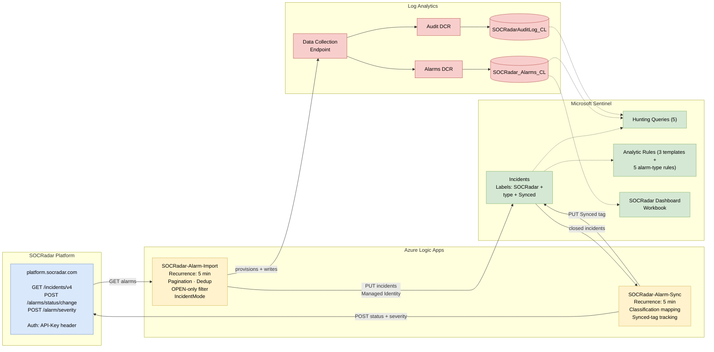

# SOCRadar Intelligence for Microsoft Sentinel

## Overview

The SOCRadar solution for Microsoft Sentinel provides bidirectional integration between SOCRadar XTI Platform and Microsoft Sentinel. Import SOCRadar alarms as Microsoft Sentinel incidents and sync closed incidents back to SOCRadar with classification mapping.

## Architecture

## Key Features

**Alarm Import**
- Automatically imports SOCRadar alarms as Microsoft Sentinel incidents
- Paginated fetching with duplicate prevention
- Severity and status mapping
- Tags for categorization (SOCRadar, alarm type, sub type)
- Optional closed alarm import with classification
- Incident mode (`IncidentMode`, default `AlertBacked`): the import writes each alarm to `SOCRadar_Alarms_CL` and five scheduled analytics rules (lookalike and phishing domain, credential exposure, data leak and PII, vulnerability and CVE, other alarms) raise one alert and one incident per alarm, with the entities and custom details of that alarm type. The incidents are listed in the Microsoft Defender portal, and arrive typically 20 to 30 minutes after the alarm is imported (measured 19 to 29). `Direct` creates the incidents through the Microsoft Sentinel API instead; they do not appear in the Defender queue (per Microsoft documentation; measured on this product only for `AlertBacked`). In `AlertBacked` the **SOCRadar High or Critical Severity Alarm** analytics rule template is redundant (every open alarm already raises an incident); leave it disabled. `EnableCredentialRule=false` switches off the credential rule (those alarms then get no incident). Each alarm is written once and the incident is Microsoft Sentinel's to create; if the platform skips a rule run, those alarms are not re-alerted (`Direct` has no such dependency)
- Redeploying an existing `Direct` install without setting `IncidentMode` switches it to `AlertBacked`: the first import reads from the last checkpoint if the install has one, otherwise `InitialLookbackMinutes` (600 minutes by default), and every alarm in that window gets a second, rule-created incident. The daily rescan is wider: the first run after 09:00 UTC reads 5 days back, and an alarm that `Direct` imported has no `alarm-<id>` row, so within those 5 days it gets a second incident, once. Close the old ones, or pass `IncidentMode=Direct` to keep the previous behaviour
- Redeploying with `IncidentMode=Direct` switches the five rules and the labeling automation rule off while `EnableAlarmsTable` is `true`. With the table off (the playbook default) that step is skipped: rules left by an earlier `AlertBacked` deployment stay enabled, but nothing feeds them any more

**Bidirectional Sync**
- Closed incidents in Microsoft Sentinel update alarm status in SOCRadar; closed incidents without the Synced tag are retried for 24 hours. Sync reads the alarm id from the incident title, or from its URL entity when Microsoft Defender renamed the incident
- Classification mapping: TruePositive to Resolved, FalsePositive to False Positive, BenignPositive to Mitigated

**Analytics**
- SOCRadar Dashboard workbook with severity, status, alarm type, alarm-to-incident, sync status and timeline panels
- 5 hunting queries for alarm analysis and correlation
- Optional audit logging for operational monitoring

## Prerequisites

- Microsoft Sentinel workspace
- SOCRadar XTI Platform API Key ([socradar.io](https://socradar.io))
- SOCRadar Company ID

## Installation

Install the SOCRadar solution from the Microsoft Sentinel **Content Hub**, then create each playbook from its template.

1. In Microsoft Sentinel, go to **Content Hub**
2. Search for **SOCRadar** and click **Install**
3. Go to **Configuration** &gt; **Automation** &gt; **Playbook templates**
4. Create the **SOCRadar-Alarm-Import** playbook. Deploying this playbook provisions all of its Log Analytics infrastructure — Data Collection Endpoint, custom tables (`SOCRadar_Alarms_CL`, `SOCRadarAuditLog_CL`), Data Collection Rules, and the required role assignments for the Logic App Managed Identity — along with the alarm import Logic App itself.
5. (Optional) Create the **SOCRadar-Alarm-Sync** playbook for bidirectional sync back to SOCRadar.
6. (Optional) Create the **SOCRadar-IOC-Enrichment** playbook, then add an automation rule (incident created -> run playbook). It needs a SOCRadar API key with the IOC Enrichment entitlement.

Logic Apps start 3 minutes after deployment to allow Azure role propagation.

## Playbooks

| Playbook | Description |
|----------|-------------|
| [SOCRadar-Alarm-Import](Playbooks/SOCRadar-Alarm-Import) | Imports SOCRadar alarms as Microsoft Sentinel incidents, through five scheduled analytics rules by alarm type (`IncidentMode` `AlertBacked`, the default) or directly (`Direct`). Provisions the DCE, custom log tables, and DCRs required by this solution. |
| [SOCRadar-Alarm-Sync](Playbooks/SOCRadar-Alarm-Sync) | Syncs closed Microsoft Sentinel incidents back to SOCRadar with classification mapping. |
| [SOCRadar-IOC-Enrichment](Playbooks/SOCRadar-IOC-Enrichment) | Enriches the entities of new incidents (IP, domain, URL, file hash) with SOCRadar IOC Enrichment and posts the result as an incident comment. Runs from an automation rule. |

All playbooks use Managed Identity for authentication.

## About SOCRadar

SOCRadar is an Extended Threat Intelligence (XTI) platform that provides actionable threat intelligence, digital risk protection, and external attack surface management.

Learn more at [socradar.io](https://socradar.io)

## Support

- **Detailed Documentation (SOCRadar customers):** [Microsoft Sentinel Integration (Bi-Directional)](https://help.socradar.io/hc/en-us/articles/41316851769745-Microsoft-Azure-Sentinel-Integration-Bi-Directional)
- **Support:** integration@socradar.io
